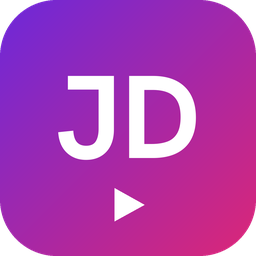
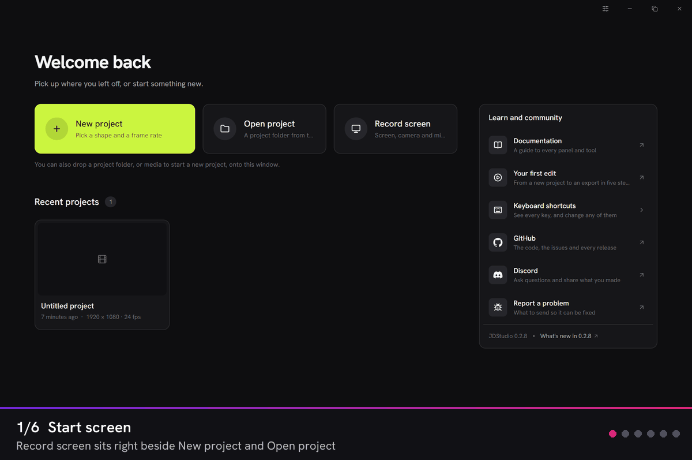
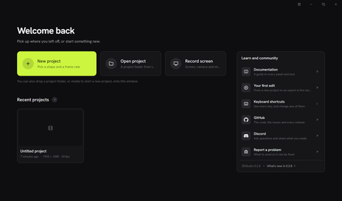
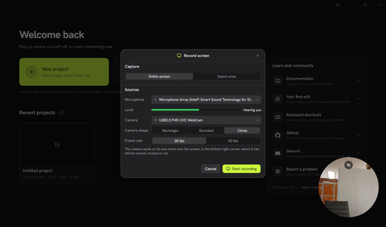
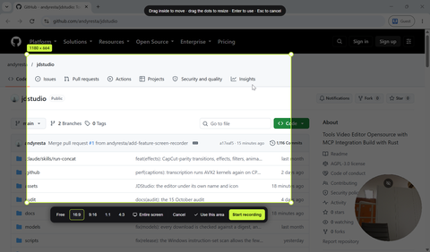
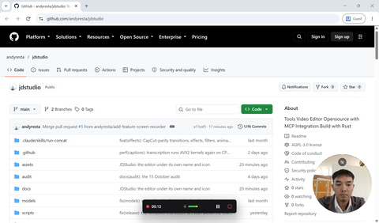
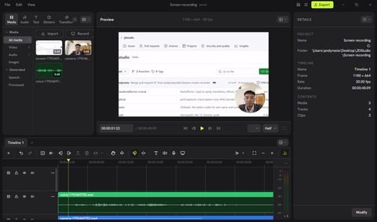
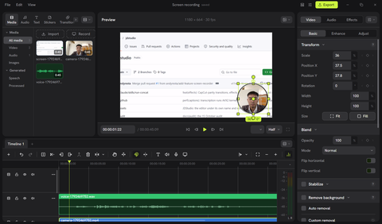

<p align="center">
  
</p>

<h1 align="center">JDStudio</h1>
<h3 align="center">Record your screen, cut it, ship it: one desktop app, fully offline.</h3>

<p align="center">
  <a href="LICENSE"></a>
  
  
</p>

---

JDStudio is a desktop video editor with a **screen recorder built in**. Pick the
whole screen or drag out an area, turn on your webcam and microphone, press
record, and when you stop, the recording is already laid out on the timeline:
screen on one track, webcam in the corner on its own track, voice underneath,
all in sync and ready to cut.

Everything runs on your own machine. No account, no watermark, no upload.

> **JDStudio is a fork of [Concat](https://github.com/jub0t/Concat)** by Jareer
> and the Concat contributors, an open-source video editor written in Rust.
> JDStudio keeps Concat's editing engine and adds the recording workflow
> described below. It is an independent project, not affiliated with or
> endorsed by Concat. See [Credits and license](#credits-and-license).

## See it in action

<p align="center">
  
</p>

<table>
  <tr>
    <td align="center" width="33%">
      <a href="docs/screenshots/start-screen.png"></a><br />
      <b>Start screen</b><br /><sub>Record screen beside New and Open project</sub>
    </td>
    <td align="center" width="33%">
      <a href="docs/screenshots/recorder.png"></a><br />
      <b>Recorder</b><br /><sub>Microphone with live level, webcam, camera shape</sub>
    </td>
    <td align="center" width="33%">
      <a href="docs/screenshots/area-picker.png"></a><br />
      <b>Area picker</b><br /><sub>Draw, resize, snap to 16:9 · 9:16 · 1:1 · 4:3</sub>
    </td>
  </tr>
  <tr>
    <td align="center" width="33%">
      <a href="docs/screenshots/recording.png"></a><br />
      <b>Recording</b><br /><sub>Floating bar and round webcam preview</sub>
    </td>
    <td align="center" width="33%">
      <a href="docs/screenshots/editor.png"></a><br />
      <b>Into the editor</b><br /><sub>Screen, webcam and voice already on the timeline</sub>
    </td>
    <td align="center" width="33%">
      <a href="docs/screenshots/webcam-clip.png"></a><br />
      <b>Still editable</b><br /><sub>The webcam is a normal clip with its circle mask</sub>
    </td>
  </tr>
</table>

<p align="center"><sub>Click any picture for the full size.</sub></p>

## What JDStudio adds

### 🎬 Screen recorder
- **Two ways in**: *Record screen* on the start screen makes a new project the
  exact size of what you recorded; *Record screen* in the editor (timeline
  toolbar, media panel or File menu) drops the recording into the open project
  at the playhead.
- **Entire screen or an area.** The area picker freezes the screen and lets you
  draw a region, then **move it, resize it from eight handles**, or snap it to
  **16:9, 9:16, 1:1 or 4:3**. Start recording straight from the picker.
- **Webcam and microphone** picked from your devices and remembered for next time.
- **3-second count-in**, then a small floating bar with the time, a live mic
  meter, **Pause/Resume** and **Stop**. On Windows the bar is hidden from the
  capture, so it never shows up in your video.
- **Smooth hand-off**: after Stop, a single loading screen finishes the files,
  creates the project and places the clips, then fades into the editor.

### 📷 Live webcam preview
- A floating webcam panel appears as soon as you choose a camera, so you can
  check framing and lighting **before** you record.
- **Drag it anywhere**, **fold it** into a small pill and unfold it again.
- **Three shapes: rectangle, rounded or circle.** The panel itself takes the
  shape, and so does the webcam clip in the editor (cropped and masked, and
  still fully editable in the inspector).

### 🎙️ Microphone check
- A live level meter in the recorder lets you confirm your voice is actually
  coming through (*"Hearing you"*) before you start.

### 🛠️ Fixes on top of Concat
- Recent projects on the start screen no longer flicker on hover, and
  *Remove from list* can be clicked.
- The mask outline in the preview sits exactly on the mask in projects that
  are not square (16:9, 16:10, …).

## Everything else (from Concat)

JDStudio inherits Concat's full editor: multi-track timeline with ripple,
split, merge, speed and freeze frame; keyframes with a curve editor; 100 GPU
effects, filters and transitions; titles; local Whisper auto-captions;
text-to-speech and voice cloning; background removal; voice cleanup; and
H.264 / HEVC / AV1 export up to 4K60. AI models download once and then work
offline.

## Platforms

| Platform | Status |
|---|---|
| Windows 10/11 (x86_64) | ✅ Built and tested, recorder included |
| macOS, Linux | 🧪 Editor builds as in Concat; recorder code paths (AVFoundation, X11/V4L2) are in place but not yet tested |
| Android, iOS | Editor only; the screen recorder is desktop-only |

## Build from source

You need **Rust 1.93.1** (pinned in `src/rust-toolchain.toml`), the **FFmpeg 7+**
shared development libraries, **LLVM** (libclang), **cmake** and a C++
compiler. On Windows the same prebuilt dependencies CI uses are pinned with
their checksums in `scripts/ci/deps.lock` and fetched with `scripts/ci/fetch.sh`:

```sh
bash scripts/ci/fetch.sh ffmpeg-win64 ffmpeg.zip
bash scripts/ci/fetch.sh onnxruntime-win-x64 onnxruntime.zip
bash scripts/ci/fetch.sh sherpa-onnx-win-x64-shared-MT-Release-lib sherpa.tar.bz2
bash scripts/ci/fetch.sh llvm-win64 llvm.exe
```

Unpack them, then point the build at them:

```powershell
$env:FFMPEG_DIR = "<ffmpeg folder>"
$env:LIBCLANG_PATH = "<llvm>\bin"
$env:ORT_LIB_LOCATION = "<onnxruntime>\lib"; $env:ORT_PREFER_DYNAMIC_LINK = "1"
$env:SHERPA_ONNX_LIB_DIR = "<folder with sherpa-onnx-*.lib>"
$env:PATH = "$env:FFMPEG_DIR\bin;$env:ORT_LIB_LOCATION;<sherpa dlls>;$env:PATH"
```

and run it:

```sh
cd src
cargo run --profile quick -p concat --bin jdstudio
```

The first build takes 20–30 minutes; later ones are much faster. The Cargo
workspace lives in `src/`, not the repository root. Internal crate names keep
Concat's `concat-*` names, so changes can still be shared with upstream.

## Credits and license

- **Concat** © 2026 Jareer and Concat contributors, the foundation of this
  project: <https://github.com/jub0t/Concat>.
- **JDStudio changes** © 2026 Andy Resta.

JDStudio is free software under the **GNU Affero General Public License
v3.0 or later**, the same license as Concat; see [`LICENSE`](LICENSE). The
source of every build is this repository. Third-party components are listed
in [`THIRD_PARTY_NOTICES.md`](THIRD_PARTY_NOTICES.md).

"Concat" and the Concat logo are trademarks of Jareer, used here only to
describe where JDStudio comes from (see [`TRADEMARK.md`](TRADEMARK.md)).
JDStudio uses its own name and icon.

---

<sub>🇮🇩 **Ringkasan:** JDStudio adalah editor video desktop dengan perekam layar
bawaan: pilih seluruh layar atau area, aktifkan webcam (kotak, sudut bulat, atau
lingkaran) dan mikrofon dengan meter suara, lalu hasil rekaman langsung tersusun
di timeline. Proyek ini adalah fork dari Concat (AGPL-3.0) dan berjalan
sepenuhnya offline.</sub>
